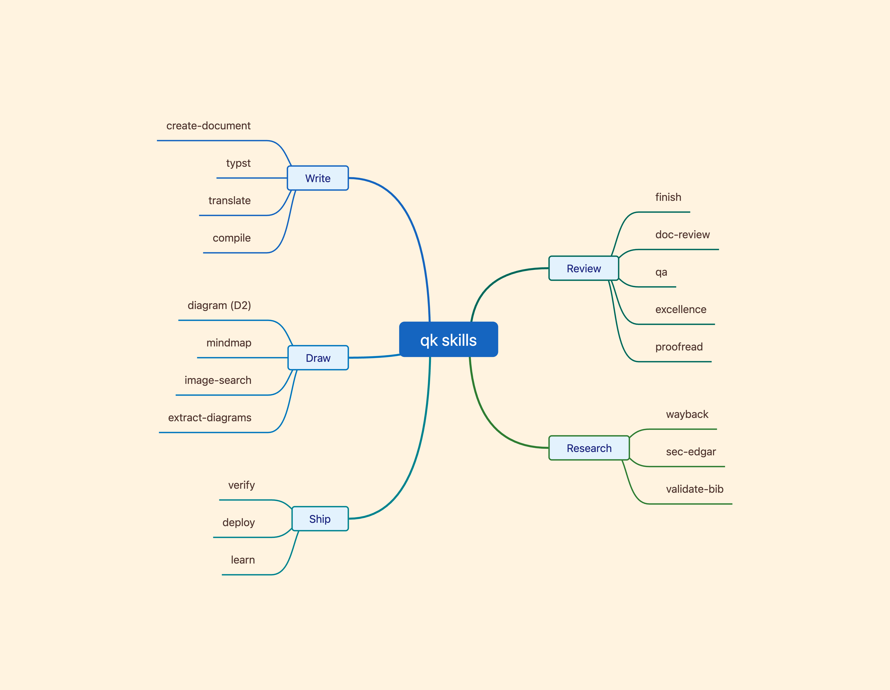
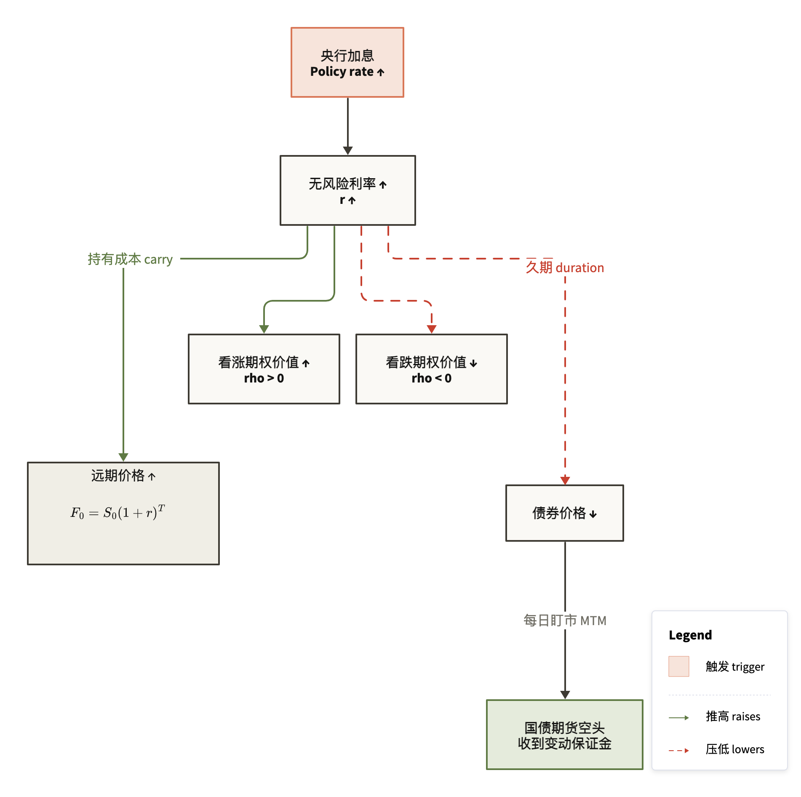

<h1 align="center">qk skills for Claude Code</h1>

<p align="center">
  24 skills that draw diagrams, write and review Typst documents, recover dead web pages,<br>
  pull SEC filings, and check that work actually runs before Claude calls it done.
</p>

<p align="center">
  
  
  
  <a href="LICENSE"></a>
</p>

<picture>
  <source media="(prefers-color-scheme: dark)" srcset="docs/images/mindmap-dark.png">
  
</picture>
<p align="center"><sub>The map above was drawn by <code>/mindmap</code>.</sub></p>

## Install

As a plugin (Claude Code 2.1.275 or later):

```
/plugin install qk-skills --marketplace clearsmog/claude-skills
```

On older versions, add the marketplace first:

```
/plugin marketplace add clearsmog/claude-skills
/plugin install qk-skills@clearsmog
```

Plugin skills are namespaced, so `/diagram` becomes `/qk-skills:diagram`.

Or clone the repo as your personal skills directory, which keeps the short names:

```bash
git clone https://github.com/clearsmog/claude-skills.git ~/.claude/skills
cp ~/.claude/skills/rules/*.md ~/.claude/rules/   # optional: always-on Typst and plotting rules
```

If you already have a `~/.claude/skills` directory, clone elsewhere and symlink the skill folders you want.

## What's inside

### Draw

| Skill | What it does |
|---|---|
| **diagram** | D2 diagrams with a light and a dark version: sequence and swimlane, flowcharts, causal networks, state machines, layered maps, step-by-step walkthroughs. Lints the source, renders SVG and PNG, and makes Claude look at the result before handing it over |
| **mindmap** | Mind maps from a topic or an indented outline, as PNG or SVG, in three themes |
| **image-search** | Finds and downloads real photos, logos and license-clear stock images, with Typst embedding code |
| **extract-diagrams** | Exports CeTZ diagrams from a Typst file to SVG |

<picture>
  <source media="(prefers-color-scheme: dark)" srcset="docs/images/causal-rate-hike.dark.png">
  
</picture>
<p><sub>A causal network from <code>/diagram</code>, using its bundled example. Labels can mix CJK, English and LaTeX.</sub></p>

### Write

| Skill | What it does |
|---|---|
| **create-document** | One prompt to a finished document: finds source material, copies the style of sibling files, drafts, compiles, checks the render and fixes what it finds |
| **typst** | Typst reference loaded on demand: syntax, templates, a component library, visual-tool routing, and an offline API and package search |
| **compile** | Compiles `.typ`, `.qmd` or `.py` with the right command for the format |
| **translate** | Converts documents between Typst and Quarto |

### Review

| Skill | What it does |
|---|---|
| **finish** | The full pipeline: compile, visual check, auto-fix, review, fix again, score |
| **doc-review** | Picks reviewers for the file type and runs them in parallel |
| **qa** | Critic and fixer loop, up to 5 rounds |
| **excellence** | Four reviewers at once (visual, pedagogy, proofreading, domain) for milestone drafts |
| **visual-audit** | Overflow, font consistency, repeated components, spacing |
| **pedagogy-review** | Narrative arc, prerequisites, worked examples, notation, pacing |
| **proofread** | Grammar, typos, consistency, academic style |
| **devils-advocate** | Argues against the content to find weak claims |
| **validate-bib** | Missing and unused bibliography entries |

### Research

| Skill | What it does |
|---|---|
| **wayback** | Recovers dead or changed pages from the Wayback Machine, Common Crawl and Arquivo.pt together; lists captures, fetches them as text, and word-diffs two versions |
| **sec-edgar** | US company filings from SEC EDGAR's free APIs: 10-K/10-Q/8-K text, full-text search since 2001, XBRL financials |

### Ship

| Skill | What it does |
|---|---|
| **verify** | Before a commit or "done": compiles changed files, runs the project's tests and build, and click-tests frontend changes in a real browser |
| **deploy** | Deployment workflow |
| **learn** | Turns something learned in the current session into a reusable skill |
| **context-status** | Context usage and session health |
| **google-tasks** | Google Tasks through the `gtasks` CLI |

## How the document skills fit together

```
/create-document "study guide on portfolio theory"
        |
        v
  find materials -> draft -> compile -> check render -> fix (up to 3 rounds)
        |
        v
  want a deeper pass?
        |
   /finish ──> /doc-review + /qa loop ──> fix ──> score
        |
   /excellence ──> 4 reviewers in parallel ──> report
```

With `rules/typst.md` installed, Claude picks a visual tool whenever it edits a `.typ` file:

```
Can Typst draw it natively?            ->  Typst (tables, boxes, fletcher flowcharts)
Structured diagram, 10 nodes or fewer? ->  fletcher, chronos, timeliney
Bigger, multi-party or a network?      ->  /diagram (D2 SVG)
Most charts?                           ->  lilaq (native Typst, font-matched)
Simple chart (< 3 series)?             ->  cetz-plot
Complex or Python data pipeline?       ->  matplotlib
Real photo or logo?                    ->  /image-search
Mind map or concept tree?              ->  /mindmap
```

## Usage examples

```bash
/diagram "settlement of an FX swap between two banks and a CLS member"
/mindmap "Risk Parity" --theme dark --format svg
/image-search --logo "Stripe"
/image-search --stock "sustainable energy" -n 2
/wayback "what did https://example.com/careers say in 2023?"
```

| `/mindmap` flag | Default | Effect |
|---|---|---|
| `--format` | `png` | `png` or `svg` |
| `--theme` | `academic` | `academic`, `latte` or `dark` |
| `--direction` | `side` | `side`, `right` or `left` |
| `--typst` | off | Print Typst embedding code |

| `/image-search` flag | Default | Effect |
|---|---|---|
| `--logo` | off | Treat the query as a company name and fetch its logo |
| `--stock` | off | Search Unsplash and Pexels (license-clear) |
| `--url` | none | Download from a given URL |
| `-n` | `1` | Number of images |

## Requirements

Every skill with scripts uses [uv](https://docs.astral.sh/uv/) (`brew install uv`).

| Skill | Also needs |
|---|---|
| **diagram** | [D2](https://d2lang.com) (`brew install d2`) and Google Chrome |
| **typst**, **compile** | [Typst CLI](https://github.com/typst/typst) (`brew install typst`) |
| **mindmap** | Node.js; uses Puppeteer's Chrome, or your installed Chrome if that is missing |
| **image-search** | `SERPAPI_KEY` optional (DuckDuckGo is the free fallback); `UNSPLASH_ACCESS_KEY` / `PEXELS_API_KEY` for `--stock` |
| **sec-edgar** | `SEC_USER_AGENT`, an app name plus contact email (SEC rejects requests without one) |
| **google-tasks** | The `gtasks` CLI |

## Credits

- The Typst API and package search scripts and indexes come from [lucifer1004/claude-skill-typst](https://github.com/lucifer1004/claude-skill-typst) (MIT); its license is in `typst/scripts/LICENSE`.
- For literature search and citation work, see [K-Dense-AI/scientific-agent-skills](https://github.com/K-Dense-AI/scientific-agent-skills).

## License

MIT
